<p align="center">
  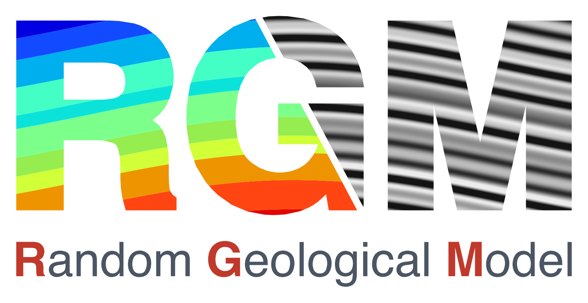
</p>

# Description
**RGM: Random Geological Model generation package**

`RGM` is an open-source package for generating realistic random geological models, including medium parameter models, seismic images, geological faults, relative geological time (RGT), salt bodies, karst systems, and unconformities, using a multi-randomization method. The generated data can be used to train machine learning models, e.g., geological fault detection models, the multitask inference-refinement model [MTI-MTR](https://github.com/lanl/mtl), and the seismicity-constrained fault characterization model [SCF](https://github.com/lanl/scf).

The work was supported by Los Alamos National Laboratory (LANL) Laboratory Directed Research and Development (LDRD) program. LANL is operated by Triad National Security, LLC, for the National Nuclear Security Administration (NNSA) of the U.S. Department of Energy (DOE) under Contract No. 89233218CNA000001. The research used high-performance computing resources provided by LANL's Institutional Computing program.

The code has been approved for public release under LANL approval reference O4778.

Recent changes: 
- The legacy elastic generators `rgm2_elastic` and `rgm3_elastic` are removed; use v1.0.0 if you need them. The outdated types `rgm2` and `rgm3` are included again from v2.1.0 for backward compatibility but are not maintained; new work should use `rgm2_curved` and `rgm3_curved`.
- `rgm2_curved` (2D) and `rgm3_curved` (3D) are the standard API for acoustic and elastic models, with strike-varying faults (`delta_strike`), faults that die out within the model (`yn_vary_disp`), and displacement decay away from faults (`yn_disp_decay`).
- Geomorphological unconformities (`unconf_shape`): meandering channels and canyons, and dendritic drainage channels and canyons.
- Karst cave systems (`yn_karst`), from isolated caves to connected networks.
- Thrust faults (`nthrust`): fault-bend and fault-propagation folds, imbricate fans, duplexes, and pop-ups.
- Reflector shapes: asymmetric fold trains (`refl_shape = 'fold'`) and skewed Gaussian and Cauchy bumps (`refl_skew`).
- Seismic images: dip-independent imaging (`yn_dip_independent`) and options that mimic migrated field data (`noise_type = 'migration'`, `f0_bottom`, `wave_phase`, `illum_level`, `jitter_shift`, `jitter_gain`).
- Elastic models: each layer has its own random Vp/Vs (`vpvsratio`), and the PS and SP images stack P-wave incidence angles from 10° to 40° (`angle_ps`). See [example/example_elastic.py](example/example_elastic.py).
- The standalone geomorphological generators (`meandering_channel`, `meandering_canyon`, `drainage_channel`, `drainage_canyon`, `karst_2d`, `karst_3d`) are available through `librgm`.
- A Python interface (see [python/README.md](python/README.md)): the classes `rgm.rgm2` and `rgm.rgm3` are the Fortran types `rgm2_curved` and `rgm3_curved`. For instance:
```python
import rgm

p = rgm.rgm3(n1=128, n2=128, n3=128, nf=4, seed=1234,
             delta_strike=[15, 25], yn_vary_disp=True,
             unconf=1, unconf_shape='meander_channel', yn_karst=True)
p.generate()
vp, image, fault = p.vp, p.image, p.fault    # numpy arrays
```

# Documentation
- [doc/README.md](doc/README.md) lists the parameters of `rgm2_curved` and `rgm3_curved`.
- [python/README.md](python/README.md) documents the Python interface.
- [doc/rgm_v2](doc/rgm_v2) contains the figures of the v2.0 paper together with the scripts that reproduce them ([doc/rgm_v2/README.md](doc/rgm_v2/README.md)).

# Requirement
`RGM` is written in modern Fortran and depends on [`FLIT`](https://github.com/lanl/flit), which in turn requires the Intel oneAPI compilers (`ifx`, or `mpiifx` when `FLIT` is built with `use_mpi = on`) and the Intel MKL. Install `FLIT` first, then set `flitdir = ...` in [src/Makefile](src/Makefile) to point at your `FLIT` installation.

The Python interface additionally requires Python >= 3.8 and `numpy`; the Python example scripts also use [`pymplot`](https://github.com/lanl/pymplot) for plotting.

# Installation

## `RGM` (Fortran)

```
cd src
make
```

The compiled static library `librgm.a` and the module files will be in `lib`. The [Makefile](example/Makefile) in the [example](example) directory shows how to use `RGM` in your own code, including the include paths and how to link the compiled library.

## `rgm` (Python)

The Python interface is a thin `ctypes` wrapper around the same Fortran code -- no algorithm is reimplemented in Python -- so it needs the shared library rather than the static one:

```
cd src
make so                     # produces lib/librgm.so
cd ..
pip install -e python/
```

`make so` requires `FLIT` compiled with `-fPIC` and `python3`, which generates the C-interoperable shim.

To check the installation,

```
python3 -c "import rgm; p = rgm.rgm2(n1=101, n2=201, nf=3, seed=1); p.generate(); print(p.vp.shape)"
```

which should print `(101, 201)`.

An editable install (`pip install -e`) finds `lib/librgm.so` automatically through the repository layout. If you install the package without `-e`, or move the shared library elsewhere, point `RGM_LIB` at it:

```
export RGM_LIB=/path/to/librgm.so
```

See [python/README.md](python/README.md) for the full description of the interface.

# Use
The [example](example) directory contains several simple examples of using `RGM`. To build the Fortran examples, set `flitdir` and `rgmdir` in [example/Makefile](example/Makefile) to point at your `FLIT` and `RGM` directories, then run

```
cd example
make
```

The compiled executables will be in `example/bin`:

| Executable | Source | Generates |
| --- | --- | --- |
| `x_generate_curved_2d` | [example_rgm2_curved.f90](example/example_rgm2_curved.f90) | 2D models covering faults, thrust faults, folding, unconformities, salt, karst, and elastic parameters |
| `x_generate_curved_3d` | [example_rgm3_curved.f90](example/example_rgm3_curved.f90) | the corresponding 3D models |
| `x_generate_channel` | [example_channel.f90](example/example_channel.f90) | models with the four geomorphological unconformity types, in 2D and 3D |
| `x_generate_karst` | [example_karst.f90](example/example_karst.f90) | models with karst cave systems, including karst combined with unconformities and salt |

Running these executables will generate the medium parameter models, seismic images, and the associated labels (fault attributes, RGT, facies, salt and karst masks) in the working directory. All the generated files will be in little-endian single-precision raw binary format, with dimensions specified in the respective codes.

For the Python interface, [example/example_python.py](example/example_python.py) generates one model for each feature type, [example/example_shape_noise.py](example/example_shape_noise.py) shows reflector shapes and image noise, [example/example_fault_types.py](example/example_fault_types.py) shows the fault types, and [example/example_elastic.py](example/example_elastic.py) shows elastic models. The scripts plot with `pymplot` and save the figures in the working directory:

```
cd example
python3 example_python.py
python3 example_shape_noise.py
python3 example_fault_types.py
python3 example_elastic.py
```

# Author
Kai Gao, <kaigao@lanl.gov>

We welcome feedback, bug reports, and improvement ideas on `RGM`.

If you use this package in your research and find it useful, please cite it as

* Kai Gao, 2024, RGM: Random Geological Model Generation package, GitHub Repository: [github.com/lanl/rgm](https://github.com/lanl/rgm)
* Kai Gao, Ting Chen, 2026, Generation of random geological models using multi-randomization for machine learning, Computers & Geosciences, doi: [10.1016/j.cageo.2026.106133](https://www.sciencedirect.com/science/article/pii/S0098300426000300)

The v2.0 features -- the fault generalizations, the meandering-channel, canyon, and drainage unconformities, and the karst systems -- are described in

* Kai Gao, 2026, RGM 2.0: Improved random geological modeling with realistic faults, meandering channels, canyons, and karst for machine learning in seismic interpretation, _under review with Computers & Geosciences_, LA-UR-26-27587.

# Examples

The following figures display some example models generated by RGM (LA-UR-25-27984; LA-UR-26-27587). 

## RGM v2.0

These are selected figures of the v2.0 paper. The full set, together with the scripts that reproduce them, is in [doc/rgm_v2](doc/rgm_v2).

<p align="center">
  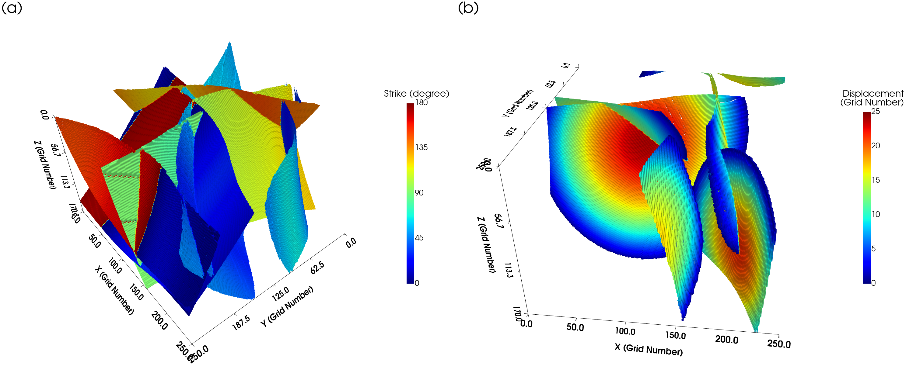
</p>
<p align="center"><strong>Fault surfaces</strong>: (a) through-going strike-varying faults, colored by local strike; (b) faults with spatially varying displacement, colored by local displacement </p>

<p align="center">
  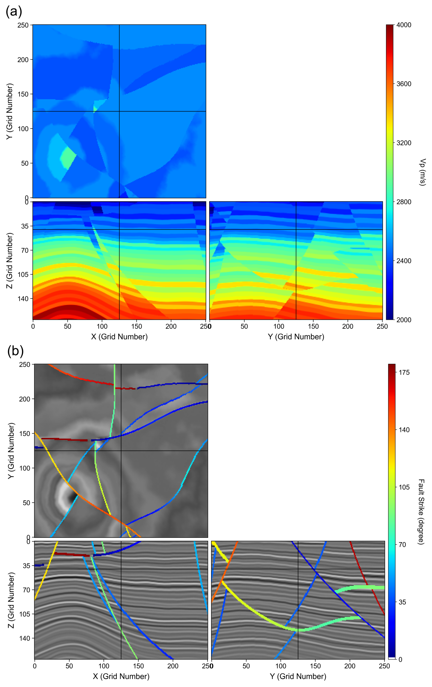
</p>
<p align="center"><strong>Strike-varying faults</strong>: (a) Vp model; (b) local strike angle overlaid on the seismic image </p>

<p align="center">
  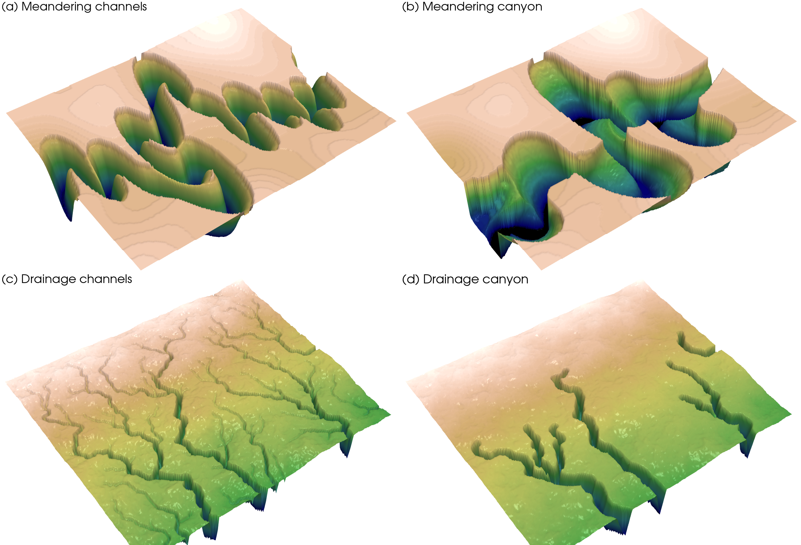
</p>
<p align="center"><strong>Erosional topographies of the four geomorphological unconformity types</strong> </p>

<p align="center">
  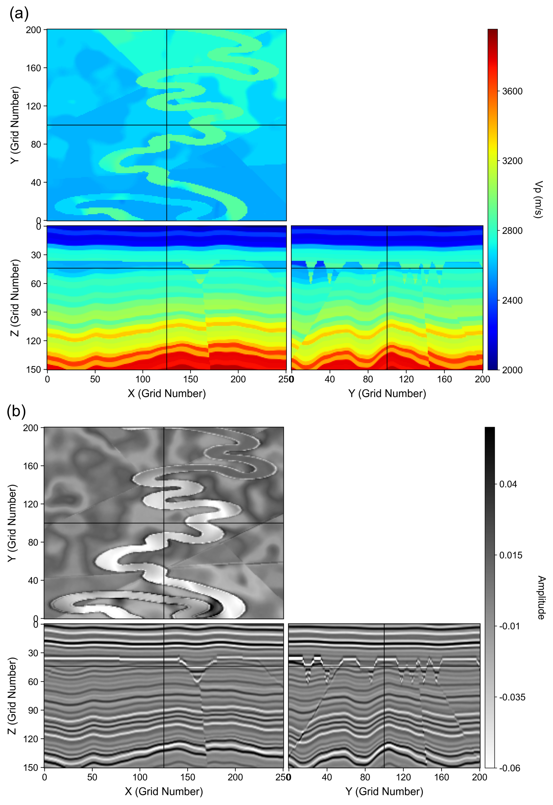
</p>
<p align="center"><strong>Meander-channel unconformity</strong>: (a) Vp model; (b) seismic image, with a depth slice through the erosional surface and two vertical sections </p>

<p align="center">
  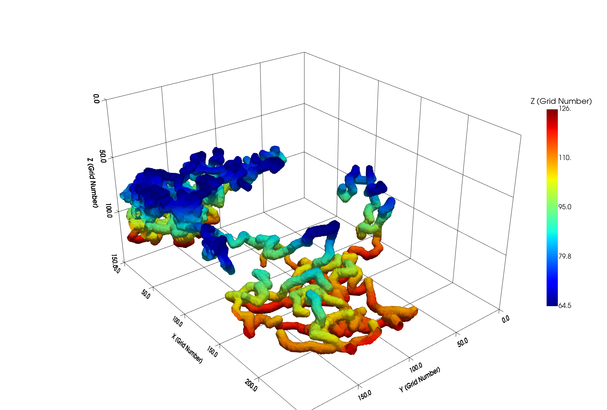
</p>
<p align="center"><strong>Karst cave network</strong>, colored by depth, for a high connection probability </p>

<p align="center">
  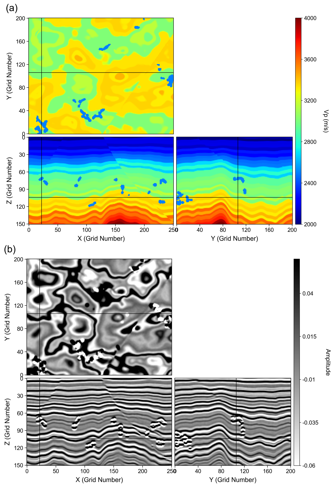
</p>
<p align="center"><strong>Embedded karst cave system</strong>: (a) Vp model; (b) the corresponding seismic image </p>

## RGM v1.0

<p align="center">
  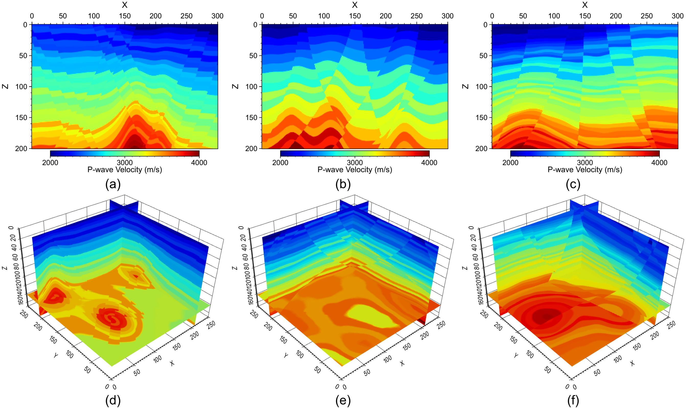
</p>
<p align="center"><strong>Faulted Vp</strong> </p>

<p align="center">
  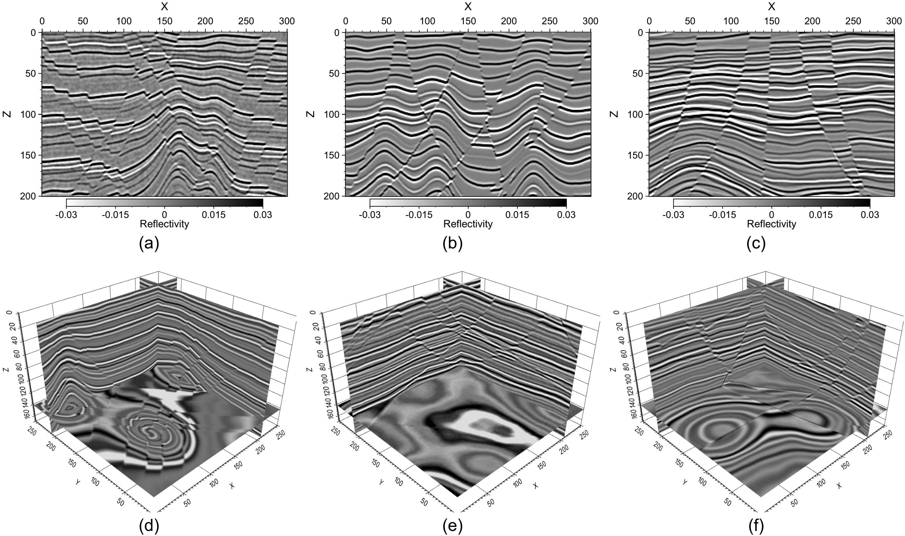
</p>
<p align="center"><strong>Seismic images</strong> </p>

<p align="center">
  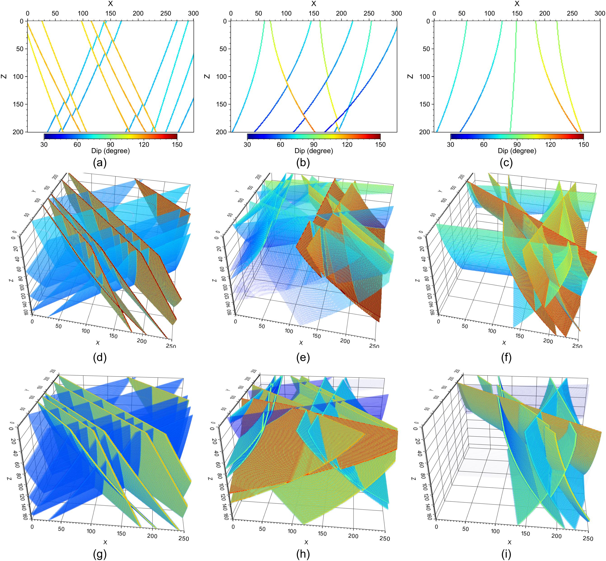
</p>
<p align="center"><strong>Fault attributes</strong> </p>

<p align="center">
  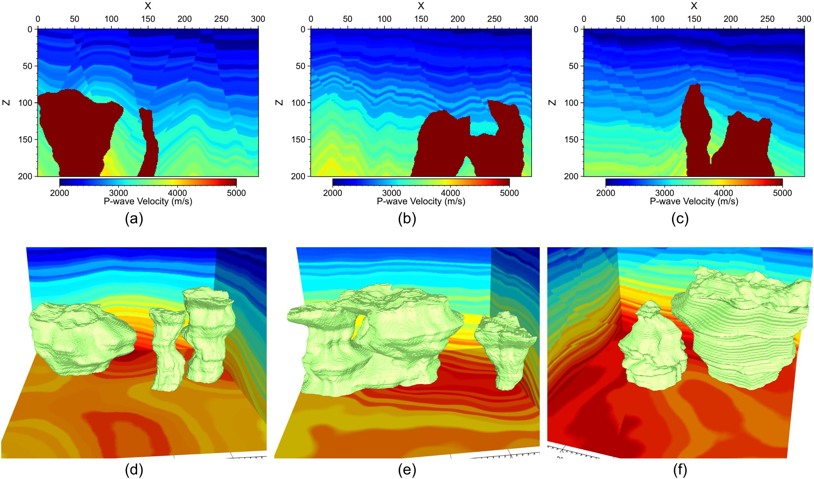
</p>
<p align="center"><strong>Salt models</strong> </p>

<p align="center">
  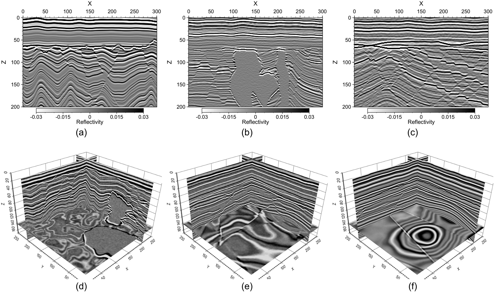
</p>
<p align="center"><strong>Seismic images of unconformity models</strong> </p>

<p align="center">
  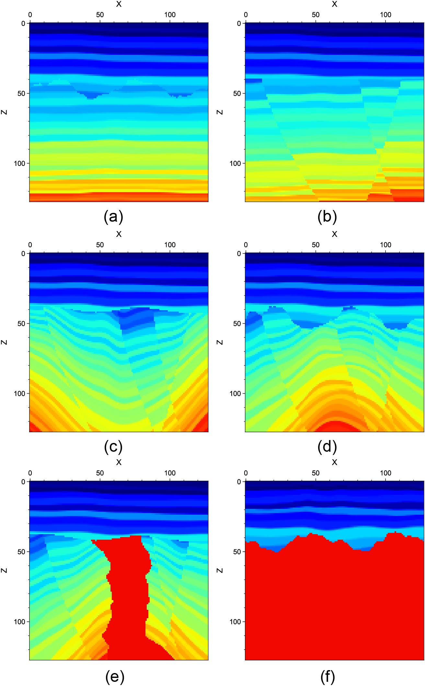
</p>
<p align="center"><strong>Types of unconformities</strong> </p>

<p align="center">
  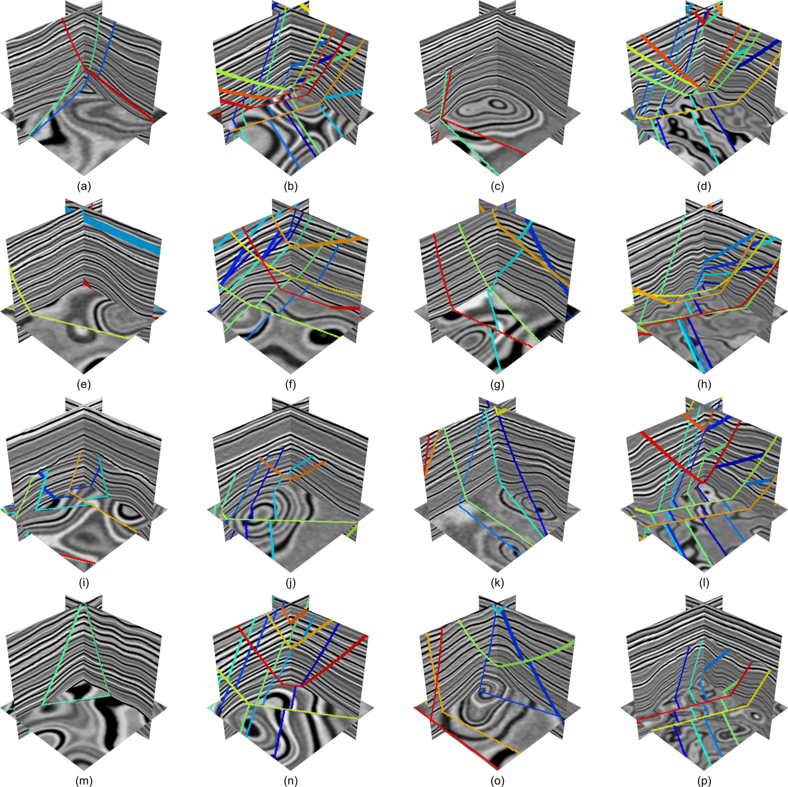
</p>
<p align="center"><strong>Labeled seismic images</strong> </p>
